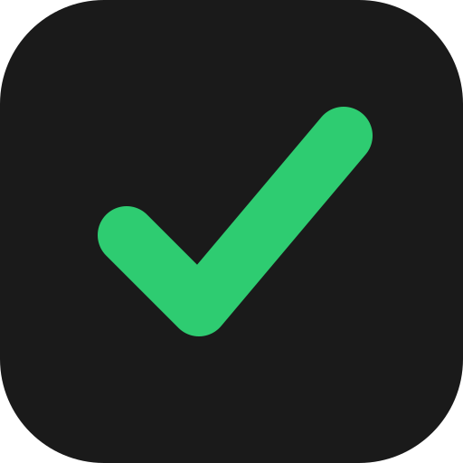

<p align="center"></p>
<h1 align="center">Attendance Tracker</h1>
<p align="center"><strong>Know where you stand. Plan what comes next.</strong></p>
<p align="center">Keep course attendance, daily classes, semester dates, and important events together—so you can make informed choices all semester long.</p>
<p align="center"><a href="https://coder-2419.github.io/Attendance-tracker/"><strong>Open Attendance Tracker →</strong></a></p>

---

## Your semester, easier to manage

Attendance Tracker turns scattered class records into a simple daily routine: see your progress, mark each class, and understand how your next decision could affect your target.

### 📊 See your attendance clearly

- Track present and absent counts and percentages for every course.
- Set a target and see your bunk buffer—or how many classes you need to attend to recover.
- Export your records as **Excel / CSV** or print a clean **attendance report PDF**.

### 🗓️ Stay on top of today

- View your classes in a day-by-day timetable and mark each one **Present**, **Absent**, or **Cancelled**.
- Unmarked classes are recorded absent after their scheduled end time.
- Edit your timetable across the week, then choose whether to save it as your default.

### 🔭 Make a plan before you miss a class

Use the **What-If Simulator** to explore future attendance scenarios. Choose a course, adjust classes to attend or miss, and see the projected percentage and target status update instantly. Your experiments never change your saved attendance.

### 📅 Make the semester calendar yours

Set the semester start and end dates once. Dates before the semester starts and future dates are blocked for attendance marking. Mark eligible days present, and use the calendar to spot dates with scheduled events.

### 🎟️ Keep important dates in view

Add exams, assignments, fests, holidays, personal plans, and club events. Filter and sort the list, then swipe through the event banner to see what’s coming up or what just passed.

> Events are stored on the current device and do not sync between devices.

### 🎓 Keep semesters separate

Switch between **Sem 1–Sem 8**, each with its own courses, attendance, calendar, and target. Share a timetable with classmates using a code, then merge it with your schedule or replace your timetable.

### 🌙 Made for everyday use

Use Attendance Tracker on mobile or desktop, switch between light and dark themes, and sign in to access your account data and cloud sync.

---

## Get started

1. [Open the app](https://coder-2419.github.io/Attendance-tracker/) and sign in.
2. Add your courses and set your attendance target in **Settings**.
3. Add or edit your weekly timetable, then set the semester start and end dates.
4. Mark classes as you go. Check the course cards whenever you want a quick progress view.

  ```sh
  firebase deploy --only firestore:rules --project attendance-tracker-2fe63
  ```

Clearing browser storage removes device-local data. Export a report or preserve important information before clearing it.
